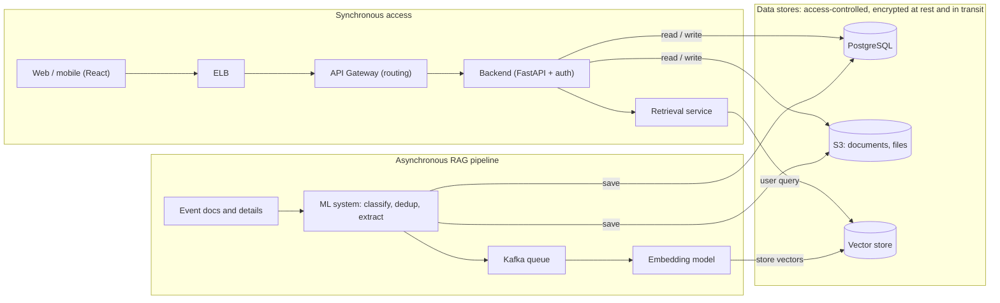

# Event Portal: High-Level Design

## Overview

The portal lets organizers publish events and attendees register for them, with each organizer's data kept separate. It has two paths:

- **Synchronous path:** web and mobile clients call the API to create, edit and browse events and to register.
- **Asynchronous path:** event documents and details are processed in the background into a retrieval (RAG) system, so users can search events in natural language.

Access controls sit in front of every data store.

## Architecture

**Synchronous access.** Web and mobile clients call through the ELB and API Gateway, which routes requests to the FastAPI backend servers. The backend reads and writes relational data in PostgreSQL and files in S3.

**Asynchronous RAG pipeline.** Event documents and details go through an ML system for classification, deduplication and high-level extraction. The results are stored in S3 and PostgreSQL and added to a queue. A worker vectorizes them with an embedding model and stores the vectors in a vector store. A retrieval service answers user queries from that store.

## Technology choices

| Layer | Choice |
| --- | --- |
| Web and mobile UI | React, for interactive web and mobile interfaces |
| Backend and auth | FastAPI |
| Relational database | PostgreSQL |
| Supporting files | Amazon S3 |
| Compute | AWS EC2 instances |
| Event queue | Kafka |
| Search | Embedding model, vector store and a retrieval service |

**Security.** IAM access restrictions are in place, and all data stores are encrypted at rest and in transit.

**Third-party tools.** Calendar, travel agent and similar tools are linked from the frontend. Only non-sensitive data is shared with them, such as event dates and sessions.

## Process workflows

### Organizer: manage events

1. The organizer creates, edits or deletes an event.
2. Event metadata and fields are saved to PostgreSQL, and supporting documents to S3.
3. An entry is added to the Kafka queue.
4. A worker picks up the entry and sends the content to the embedding model.
5. The resulting vectors are stored in the vector store.

### Attendee: register for an event

1. The attendee registers for an event.
2. The attendee is authenticated.
3. The registration is added to the approval queue.
4. The approver gets a notification in their dashboard.
5. Once approved, the attendee is added to the participants table in the events database.

## AWS multi-region installation

Run the full stack in at least two regions based on enterprise locations and accessibility. The stateless tiers serve traffic in every region, PostgreSQL takes writes in the primary region, and every data store replicates to the secondary so it can take over if the primary fails.

### Components per region

| Component | In each region | Cross-region setup |
| --- | --- | --- |
| DNS | Health checks on each region's load balancer | Route 53 latency-based routing sends users to the nearest healthy region |
| Web and mobile assets | React assets can be served via cloudfront
| Load balancer and API gateway | ELB and API Gateway | Same configuration deployed to both regions | API gateway can be autoscaled - eg nginx using kubernetes/docker
| Backend (FastAPI) | EC2 Auto Scaling group across at least 2 availability zones | Authentication reaching out to enterprise specific user accounts |
| PostgreSQL | Aurora PostgreSQL cluster | Aurora Global Database: one writer region, read-only replica in the secondary, managed failover |
| Supporting files | S3 bucket | S3 Cross-Region Replication between the buckets |
| Kafka | Amazon MSK cluster | MSK Replicator copies the event topics to the other region |
| Embedding workers and vector store | Workers consume the local Kafka topic and write to a local vector store | Vector stores are partitioned by enterprise as well as events
| Secrets and keys | Secrets Manager, KMS | Replicated secrets and KMS multi-region keys, so encrypted data opens in both regions |

### Handling writes

Reads are served locally in every region. Writes (event changes, registrations, approvals) go to the primary region's database. Read replicas may have stale data but eventual consistency will be there

### Failover

1. Route 53 health checks; use secondary backup system in different region
2. Database failovers managed with backup secondary stores
3. Point the backend's write path to the new writer, ideally through a config value
4. Kafka consumers in the secondary continue from the replicated topics.
5. When the old primary recovers, rejoin it as the secondary and fail back in a planned window.

### Installation steps

1. CloudFormation used for deployment in multiple regions
2. Create the VPC, subnets across at least 2 availability zones, and security groups in each region.
3. Create KMS multi-region keys and replicate secrets.
4. Create the Aurora Global Database, the S3 buckets with replication, and the MSK clusters with MSK Replicator.
5. Build the backend AMI once, copy it to each region, and create the Auto Scaling groups behind ELB and API Gateway.
6. Deploy the embedding workers and vector store in each region.
7. Publish the React build to S3 behind CloudFront.

